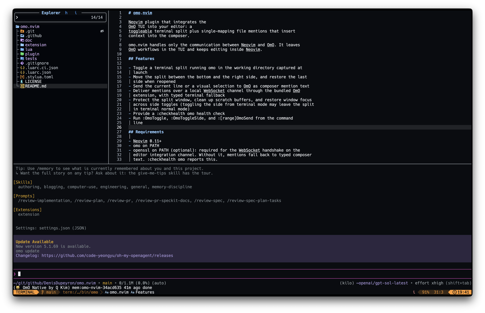

# omo.nvim

Neovim plugin that integrates the
[OmO](https://github.com/code-yeongyu/oh-my-openagent) TUI into your editor: a
toggleable terminal split plus single-mapping file mentions that insert
context into the composer.

`omo.nvim` handles only the communication between Neovim and OmO. It leaves
OmO workflows in the TUI and keeps editing inside Neovim.



## Features

- Toggle a terminal split running `omo` in the working directory captured at
  launch
- Move the split between the bottom and the right side, and restore the last
  side when reopened
- Send the current line or a visual selection to OmO as composer mention text
- Deliver mentions over a local WebSocket channel through the bundled OmO
  extension, with typed terminal fallback
- Protect the split window, clean up scratch buffers, and restore window focus
  across side toggles (toggling the side from terminal mode may leave the split
  in terminal normal mode)
- Provide a `:checkhealth omo` health check
- Run `:OmoToggle`, `:OmoToggleSide`, and `:[range]OmoSend` from the command
  line

## Requirements

- Neovim 0.11+
- `omo` on `PATH`
- `openssl` on `PATH` (optional): required for the WebSocket handshake on the
  editor integration channel. Without it, mentions fall back to typed composer
  text. `:checkhealth omo` reports this.

## Install

No package install or build step is needed.

### lazy.nvim

```lua
{
  "DenisDupeyron/omo.nvim",
  config = function()
    ---@type omo.Opts
    vim.g.omo_opts = {
      -- Your configuration, if any
    }
  end,
}
```

### vim.pack

```lua
vim.pack.add({ src = "https://github.com/DenisDupeyron/omo.nvim" })
```

### Type checking with lazydev.nvim

`---@type omo.Opts` annotations only resolve when your Lua language server
knows where to find `omo.nvim`'s type definitions. If you use
[lazydev.nvim](https://github.com/folke/lazydev.nvim), add a library entry for
it:

```lua
{
  "folke/lazydev.nvim",
  opts = {
    library = {
      { path = "omo.nvim", words = { "omo" } },
    },
  },
},
```

Without that entry, `vim.g.omo_opts` still works at runtime, though `lua_ls`
reports "Undefined type or alias `omo.Opts`" as a diagnostic.

## Configuration

The snippet below shows the default values.

```lua
---@type omo.Opts
vim.g.omo_opts = {
  -- Split height when the split is at the bottom: a ratio of the window
  -- (0 < h <= 1) or a row count (h > 1).
  height = 0.30,
  -- Split width when the split is on the side: a ratio of the window
  -- (0 < w <= 1) or a column count (w > 1).
  width = 0.40,
  -- Side for a new split: "bottom" or "right".
  side = "right",
  -- Keymaps to register. Set to false to register none. Set an individual
  -- key to false to disable only that one.
  keys = {
    toggle = "<leader>o.", -- toggle the OmO terminal
    range = "<leader>or", -- send the visual selection
    line = "<leader>ol", -- send the current line
    side = "<leader>os", -- move the split between the bottom and the right
  },
}
```

Options are read from `vim.g.omo_opts` at call time. Keymaps are registered
once on `VimEnter`, so the table can be set in either lazy.nvim's `init =` or
`config =` function.

## Usage

| Action | Default keymap | Command |
| --- | --- | --- |
| Toggle the OmO terminal | `<leader>o.` | `:OmoToggle` |
| Move the split between bottom and right | `<leader>os` | `:OmoToggleSide` |
| Send the current line | `<leader>ol` | `:OmoSend` |
| Send the visual selection | `<leader>or` | `:'<,'>OmoSend` |
| Send lines 5 to 9 | | `:5,9OmoSend` |

General terminal and TUI tips:

- Drag the window separator to resize the OmO split when mouse support is
  enabled in Neovim
- Click the OmO split or another window to focus it (clicking the OmO split in
  normal mode enters terminal insert mode)
- Press `Ctrl+j` to insert a newline in the composer
- Clear the composer with one `Ctrl+c`, or press `Ctrl+c` a second time to
  exit OmO
- Exit OmO and close the split by pressing `Ctrl+d` in an empty composer within
  the OmO split

## API

`require("omo")` returns four functions:

- `toggle()`: toggle the OmO terminal split
- `toggle_side()`: move the split between the bottom and the right
- `send_line()`: send the current line to OmO
- `send_selection()`: send the current visual selection to OmO

## Editor integration

When the OmO terminal starts, `omo.nvim` launches `omo -e` with its bundled
extension and listens on a local loopback WebSocket. It passes the port in
`OMO_EDITOR_SSE_PORT` and blanks `TMUX` and `STY` so OmO does not wrap Kitty
image output in tmux passthrough sequences that a Neovim terminal cannot
handle.

If the bundled extension connects in TUI mode and completes the handshake,
mentions are sent over the WebSocket channel and inserted as text into the OmO
composer. Up to 20 mentions are queued while the connection finishes starting,
and dropped with a warning if the connection closes before OmO is ready. When
no ready or connecting client can accept a mention, `omo.nvim` falls back to
typing the same mention string directly into the terminal channel.

Both channels format a single line as `@bar.lua#5` and a line range as
`@bar.lua#5-9`, with no trailing space. Paths inside the launch working
directory are formatted relative to that directory, and paths outside it stay
absolute. Missing or invalid extension paths are reported by OmO itself.

## Health

Run `:checkhealth omo` to verify the Neovim version, the `omo` binary,
`openssl`, `+winfixbuf` support, and the editor integration state.
